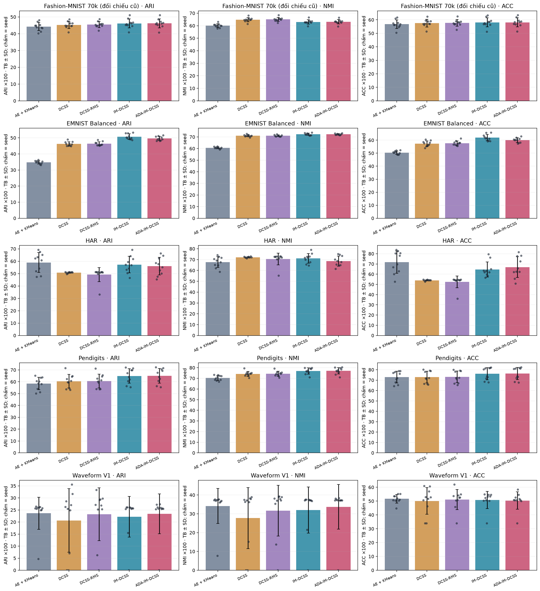

# Đánh giá hiệu năng và độ ổn định của các phương pháp phân cụm sâu

Nghiên cứu thực nghiệm về **DCSS, IM-DCSS và ADA-IM-DCSS**, đối chiếu với **AE + KMeans** trên dữ liệu ảnh, dạng bảng và văn bản. Bộ kết quả chính gồm **6 bộ dữ liệu × 5 phương pháp × 10 seed = 300 kết quả**: 50 kết quả Fashion-MNIST 70k được giữ từ đợt trước và 250 kết quả của năm bộ bổ sung. Bản thống kê được kiểm tra ngày **15/11/2026**.

**Kết luận hiện tại:** trên Fashion-MNIST 70k, ADA-IM-DCSS tăng ARI và ACC trung bình nhưng giảm NMI so với DCSS được tái triển khai. Trên năm bộ bổ sung, chưa có phép so sánh chính ADA-IM với IM đạt mức ý nghĩa 0,05 sau hiệu chỉnh Holm. Dữ liệu hiện có **chưa xác nhận lợi ích bổ sung rõ ràng của ADA**; kết quả phụ thuộc bộ dữ liệu và thước đo.

## 1. Đọc kết quả và chạy thống kê

| Nhu cầu | Tài liệu hoặc chương trình |
| --- | --- |
| Chạy thống kê trên CPU | [Notebook thống kê độc lập](colab_multi_dataset/ThongKe_DCSS_MultiDataset.ipynb) · [Mở trên Colab](https://colab.research.google.com/drive/19ylnoBPKHPnkHUjKxmKeWdld0KQgndqq) |
| Đọc báo cáo có biểu đồ | [Báo cáo HTML](DCSS_MultiDataset_Statistics/ThongKe_DCSS_MultiDataset.html) — tải về rồi mở bằng trình duyệt |
| Lấy số liệu để phân tích tiếp | [Trung bình và SD](DCSS_MultiDataset_Statistics/summary.csv) · [Từng seed](DCSS_MultiDataset_Statistics/per_seed.csv) · [Kiểm định chính](DCSS_MultiDataset_Statistics/primary_comparisons_holm.csv) |
| Kiểm tra tiến độ và suy biến cụm | [Tiến độ](DCSS_MultiDataset_Statistics/progress.csv) · [Tình trạng cụm](DCSS_MultiDataset_Statistics/cluster_health.csv) |
| Đọc thiết kế thực nghiệm | [Giao thức Fashion-MNIST](colab_full_fashion_mnist/PROTOCOL.md) · [Giao thức năm bộ bổ sung](colab_multi_dataset/PROTOCOL.md) |
| Huấn luyện lại | [Notebook đa bộ dữ liệu](colab_multi_dataset/DCSS_ADA_IM_MultiDataset.ipynb) · [Notebook Fashion-MNIST](colab_full_fashion_mnist/DCSS_ADA_IM_FashionMNIST_Full.ipynb) |

Notebook thống kê mặc định dùng bản kết quả đã nhúng, không cần Drive, GPU hay PyTorch. Chọn **CPU → Run all** để tạo CSV, JSON, 7 biểu đồ, HTML và ZIP trong `DCSS_MultiDataset_Statistics/`. CSV/JSON giữ đơn vị gốc; bảng ARI/NMI/ACC trong README nhân 100 để dễ đọc.

## 2. Bài toán và câu hỏi nghiên cứu

Đầu vào là các quan sát không sử dụng nhãn trong hàm mất mát; đầu ra là nhãn cụm, biểu diễn học được và các thước đo đánh giá. Mạng tự mã hóa học biểu diễn, sau đó DCSS tinh chỉnh theo độ gọn và sự tách biệt của cụm thông qua điểm silhouette mềm. IM khuyến khích gán cụm rõ ràng và cân bằng phân bố; ADA bổ sung độ rộng RBF thích nghi cùng cơ chế cứu cụm.

1. Tinh chỉnh phân cụm sâu có cải thiện so với KMeans trên biểu diễn của mạng tự mã hóa không?
2. IM cải thiện như thế nào so với DCSS, và bổ sung ADA còn đem lại lợi ích gì khi đã có IM?
3. Kết quả ổn định đến đâu qua 10 seed, giữa các bộ dữ liệu và khi xuất hiện cụm suy biến?

`dcss_paper` là **bản tái triển khai được mô tả trong giao thức**, không phải số liệu do tác giả bài báo cung cấp. Những khác biệt giữa bài báo, mã công bố và lựa chọn triển khai được ghi trong giao thức Fashion-MNIST. Mạng dùng cho dữ liệu dạng bảng là điều chỉnh kiến trúc của nghiên cứu này.

## 3. Dữ liệu đã sử dụng

| Bộ dữ liệu | Quy mô thực tế | Đầu vào / số cụm K | Tiền xử lý |
| --- | ---: | --- | --- |
| [Fashion-MNIST](https://github.com/zalandoresearch/fashion-mnist) | 70.000 = 60.000 + 10.000 | Ảnh xám 28 × 28 / 10 | Chia giá trị điểm ảnh cho 255 |
| [EMNIST Balanced](https://www.nist.gov/itl/products-and-services/emnist-dataset) | 131.600 = 112.800 + 18.800 | Ảnh xám 28 × 28 / 47 | Chuyển vị để sửa hướng ảnh, chia cho 255; không dùng ByClass |
| [Human Activity Recognition](https://archive.ics.uci.edu/dataset/240/human+activity+recognition+using+smartphones) | 10.299 = 7.352 + 2.947 | 561 đặc trưng / 6 | Biến đổi cố định `(x + 1) / 2`; không dùng mã người tham gia làm đặc trưng |
| [Pen-Based Recognition of Handwritten Digits](https://archive.ics.uci.edu/dataset/81/pen+based+recognition+of+handwritten+digits) | 10.992 = 7.494 + 3.498 | 16 đặc trưng tọa độ / 10 | Chia tọa độ cho 100 |
| [Waveform Database Generator V1](https://archive.ics.uci.edu/dataset/107/waveform+database+generator+version+1) | 5.000 | 21 đặc trưng / 3 | Min–max từng cột trên toàn tập không nhãn; không dùng bản 40 đặc trưng |
| [Nemotron-Personas-Vietnam](https://huggingface.co/datasets/nvidia/Nemotron-Personas-Vietnam) | 100.000 hồ sơ cố định từ 1.000.000 | Vector văn bản 384 chiều / 20 | Chỉ dùng trường `persona`, bộ mã hóa cố định và chuẩn hóa L2 |

Nguồn tệp và SHA-256 được ghi trong [sources.json](colab_multi_dataset/sources.json), [kiểm tra dữ liệu bổ sung](colab_multi_dataset/audit/data_verification.json) và [mã kiểm tra Fashion-MNIST](colab_full_fashion_mnist/canonical_hashes.json). Dữ liệu lớn được tải khi chạy notebook, không đưa vào đợt commit này.

Mẫu Nemotron được lấy không hoàn lại trên cả **11 tệp Parquet**, dùng seed `20261111`, giữ dấu vân tay chỉ mục và định danh. Bộ mã hóa là [`paraphrase-multilingual-MiniLM-L12-v2`](https://huggingface.co/sentence-transformers/paraphrase-multilingual-MiniLM-L12-v2), revision `e8f8c211226b894fcb81acc59f3b34ba3efd5f42`, tối đa 128 token. Có **17.260/100.000 hồ sơ (17,26%)** bị cắt ngắn. Đây là hồ sơ tổng hợp, không có nhãn cụm chuẩn; K = 20 được ấn định để thăm dò. Giới tính/nghề nghiệp không được dùng làm nhãn đúng.

### Phạm vi đánh giá và rò rỉ dữ liệu

Các bộ có phân chia huấn luyện/kiểm thử gốc được **gộp lại để phân cụm toàn tập** (đánh giá chuyển dẫn, *transductive*). Nhãn chỉ dùng để chấm điểm sau khi hoàn tất huấn luyện, không dùng trong hàm mất mát, dừng sớm, chọn checkpoint hoặc chọn seed tốt nhất. K của năm bộ có nhãn sử dụng thông tin về số lớp đã biết.

Do toàn bộ quan sát tham gia học biểu diễn, đây **không phải đánh giá trên tập kiểm thử độc lập**. Fashion-MNIST 10k từng được dùng trong giai đoạn phát triển và nằm trong tập 70k. Kết quả 10k cũ được giữ riêng, không gộp với kết quả chính 10 seed.

## 4. Phương pháp và cấu hình

| Mã kết quả | Tên trình bày | Vai trò |
| --- | --- | --- |
| `ae_kmeans` | AE + KMeans | Cơ sở: KMeans trên biểu diễn sau tiền huấn luyện, không tinh chỉnh bằng DCSS |
| `dcss_paper` | DCSS | Tái triển khai với độ rộng RBF khởi tạo theo cấu hình tham chiếu |
| `dcss_rms` | DCSS-RMS | Đối chứng khởi tạo độ rộng RBF từ khoảng cách RMS |
| `im_rms` | IM-DCSS | Bổ sung cân bằng phân bố cụm và lịch tăng hệ số entropy |
| `ada_im` | ADA-IM-DCSS | IM kết hợp độ rộng thích nghi và cơ chế cứu cụm |

So sánh ADA-IM với IM đánh giá **gói bổ sung ADA như đã cài đặt**; chưa tách riêng tác động của cập nhật độ rộng và cứu cụm.

| Thành phần | Cấu hình chính |
| --- | --- |
| Seed | 0–9; báo cáo tất cả 10 lượt |
| Huấn luyện | 100 epoch tiền huấn luyện; 100 epoch tinh chỉnh cho mỗi biến thể DCSS |
| Batch / chiều tiềm ẩn | 256 / 10 |
| Tối ưu | Adam; tốc độ học tiền huấn luyện `1e-3`, tinh chỉnh `5e-4` |
| KMeans | `n_init=100`, thuật toán Lloyd trên CPU |
| Mạng cho ảnh | Mạng tích chập có chuẩn hóa theo lô theo kiến trúc tham chiếu |
| Mạng cho bảng/văn bản | Bộ mã hóa `d → 500 → 500 → 2000 → 10`; giải mã đối xứng, đầu ra tuyến tính |
| So sánh trong mỗi seed | Chung mạng tiền huấn luyện, tâm KMeans và thứ tự lô |
| Độ chính xác số | FP32; không dùng AMP/TF32 trong huấn luyện |

Mục tiêu tổng quát gồm sai số tái tạo, điểm silhouette mềm, entropy có điều kiện và thành phần cân bằng:

$$\mathcal{L}=\mathcal{L}_{rec}+\lambda_s(1-S_{soft})+\lambda_e\omega(t)H(C\mid X)+\lambda_b D_{KL}(\bar q\parallel U_K).$$

`q` là xác suất gán cụm, `q̄` là trung bình trên lô và `U_K` là phân bố đều. DCSS/DCSS-RMS dùng `λs = λe = 0,01`, không có thành phần cân bằng và không dùng lịch tăng entropy. IM/ADA-IM dùng lần lượt `0,012; 0,0025; 0,004`; hệ số entropy bằng 0 trong 70% tiến trình đầu, sau đó tăng theo nửa chu kỳ cosine. Đây là lựa chọn của thí nghiệm, không đồng nhất nguyên văn hàm mất mát SHOT. Công thức chi tiết và xử lý cụm rỗng nằm trong hai giao thức.

## 5. Kết quả

### Chất lượng phân cụm có nhãn tham chiếu

**ARI × 100, trung bình ± độ lệch chuẩn mẫu (`ddof=1`), n = 10.** Giá trị lớn hơn tốt hơn. Mỗi hàng là một bài toán riêng; không lấy trung bình giữa các bộ để xếp hạng chung.

| Bộ dữ liệu | AE + KMeans | DCSS | DCSS-RMS | IM-DCSS | ADA-IM-DCSS |
| --- | ---: | ---: | ---: | ---: | ---: |
| Fashion-MNIST 70k | 44,266 ± 2,395 | 45,210 ± 2,100 | 45,447 ± 1,841 | 46,126 ± 2,719 | 46,189 ± 2,689 |
| EMNIST Balanced | 34,754 ± 0,989 | 46,249 ± 1,346 | 46,321 ± 1,251 | 50,709 ± 1,750 | 49,630 ± 1,302 |
| HAR | 58,952 ± 8,033 | 50,783 ± 0,549 | 49,205 ± 5,668 | 57,273 ± 6,707 | 56,013 ± 7,168 |
| Pendigits | 58,554 ± 5,245 | 60,449 ± 5,777 | 60,592 ± 5,754 | 64,879 ± 6,114 | 65,060 ± 6,186 |
| Waveform V1 | 23,628 ± 6,676 | 20,655 ± 13,165 | 23,242 ± 10,968 | 22,208 ± 8,454 | 23,406 ± 8,257 |

Nguồn: [summary.csv](DCSS_MultiDataset_Statistics/summary.csv), có đủ ARI, NMI và ACC. ACC dùng ghép nhãn cụm với nhãn tham chiếu để chấm điểm sau huấn luyện, không phải học có giám sát.



Trên Fashion-MNIST 70k, ADA-IM có **ARI 46,189 ± 2,689; NMI 63,125 ± 1,752; ACC 58,125 ± 3,330**, trong khi DCSS đạt **45,210 ± 2,100; 64,804 ± 1,723; 57,513 ± 2,821**. Đây là cải thiện trung bình có đánh đổi giữa thước đo. Trên HAR và Waveform, AE + KMeans vẫn có ARI trung bình cao nhất trong bảng; không thể khẳng định tinh chỉnh sâu luôn tốt hơn.

### Lợi ích bổ sung của ADA so với IM

So sánh ghép cặp theo seed, hiệu số **ADA-IM − IM**. ARI đổi sang điểm phần trăm; silhouette giữ đơn vị gốc. Khoảng tin cậy (CI) 95% dùng phân bố t, chưa hiệu chỉnh đồng thời. Giá trị p đến từ kiểm định đổi dấu hai phía trên `2^10` tổ hợp, với giả thiết đối xứng của hiệu số dưới giả thuyết không. Holm áp dụng cho **cả năm phép so sánh chính**.

| Bộ dữ liệu / chỉ số | Hiệu số trung bình | CI 95% | p sau Holm |
| --- | ---: | ---: | ---: |
| EMNIST / ARI | −1,079 điểm % | [−1,783; −0,374] | 0,0586 |
| HAR / ARI | −1,259 điểm % | [−6,132; 3,613] | 1,0000 |
| Pendigits / ARI | +0,182 điểm % | [−0,052; 0,415] | 0,4844 |
| Waveform / ARI | +1,199 điểm % | [−1,055; 3,453] | 0,7500 |
| Nemotron / silhouette | +0,001551 | [−0,017502; 0,020605] | 1,0000 |

Nguồn: [primary_comparisons_holm.csv](DCSS_MultiDataset_Statistics/primary_comparisons_holm.csv). Fashion-MNIST là kết quả lịch sử, không gộp vào họ năm kiểm định mới. **Không phép kiểm định nào đạt 0,05 sau Holm.** Bằng chứng chưa đủ không có nghĩa hai phương pháp tương đương hoặc ADA không bao giờ có tác dụng. CI chưa hiệu chỉnh của EMNIST nằm dưới 0 nhưng p sau Holm lớn hơn 0,05 vì hai đại lượng dùng mức kiểm soát sai số khác nhau.

### Nemotron và suy biến cụm

Nemotron không có ARI/NMI/ACC theo nhãn đúng. Chỉ số nội tại được tính trong cùng không gian đặc trưng và trên cùng mẫu đánh giá 2.000 quan sát cố định giữa các phương pháp/seed.

| Phương pháp | Silhouette, trung bình ± SD | Seed hợp lệ | Số cụm có phần tử, nhỏ nhất–lớn nhất |
| --- | ---: | ---: | ---: |
| AE + KMeans | 0,026457 ± 0,000989 | 10 | 20–20 |
| DCSS | 0,088902 ± 0,014957 | 9 | 1–2 |
| DCSS-RMS | 0,104857 ± 0,001070 | 10 | 2–3 |
| IM-DCSS | −0,000079 ± 0,007678 | 10 | 16–20 |
| ADA-IM-DCSS | 0,001472 ± 0,020090 | 10 | 9–16 |

Silhouette cao khi dữ liệu dồn vào rất ít cụm không đủ để kết luận phân cụm tốt. Có **26/200 lượt tinh chỉnh mới** bị gắn cờ suy biến, tập trung ở Waveform và Nemotron; toàn bộ điểm vẫn được giữ. Chỉ số không xác định được để trống/null, không thay bằng 0. Xem [tình trạng cụm](DCSS_MultiDataset_Statistics/cluster_health.csv) và [phân bố cụm](DCSS_MultiDataset_Statistics/07_selected_cluster_distribution.png).

[Độ ổn định giữa seed](DCSS_MultiDataset_Statistics/partition_stability.csv) dùng ARI giữa các phân hoạch. Các cặp seed có phụ thuộc: 45 cặp của 10 seed phục vụ mô tả, không phải 45 lần chạy độc lập.

## 6. Tái lập và kiểm tra

### Chỉ phân tích trên máy cá nhân

Ví dụ PowerShell với Python 3.12:

```powershell
git clone https://github.com/IzumiDKC/FashionMNIST-ADA-IM-DCSS.git
cd FashionMNIST-ADA-IM-DCSS
py -3.12 -m venv .venv
.\.venv\Scripts\python.exe -m pip install -r requirements-analysis.txt
.\.venv\Scripts\python.exe -m ipykernel install --user --name dcss-analysis --display-name "DCSS analysis"
```

Mở `colab_multi_dataset/ThongKe_DCSS_MultiDataset.ipynb` bằng VS Code/Jupyter, chọn kernel **DCSS analysis** rồi Run all. Notebook có bản kết quả ngày 15/11/2026. Để đọc chiến dịch khác, dùng `SOURCE_MODE="local"` hoặc `"drive"` và chỉ rõ thư mục trong ô cấu hình.

### Huấn luyện và tiếp tục khi đổi GPU

Mở [notebook huấn luyện trên Colab](https://colab.research.google.com/drive/1im9fG_949mpbZOIxdOp_nQ0M3VfLgenV), chọn GPU CUDA được cấp và Run all. Notebook giữ PyTorch/CUDA của Colab. Xem [hướng dẫn chi tiết](colab_multi_dataset/README.md) trước khi chạy trên tài khoản Drive khác.

Checkpoint được ghi cuối mỗi epoch và định kỳ 300 giây tại ranh giới batch, có hai bản luân phiên cùng checksum. Khi đổi A100 sang L4/T4/GPU CUDA tương thích hoặc CPU, giữ nguyên tài khoản Drive, thư mục kết quả và cấu hình khoa học rồi Run all: lượt hoàn tất được bỏ qua, lượt dở tiếp tục từ checkpoint hợp lệ gần nhất. CPU chậm hơn; TPU chưa hỗ trợ. Phần chưa ghi có thể phải chạy lại. Không chạy hai phiên ghi vào cùng thư mục.

Mã, cấu hình, SHA-256 dữ liệu và lịch sử thiết bị/phần mềm được ghi trong manifest và nhật ký phiên. Đổi phần cứng/phần mềm không bảo đảm trùng từng bit; thời gian trên các thiết bị khác nhau không dùng để xếp hạng tốc độ thuật toán. Các tệp requirements mô tả phạm vi cài đặt, không thay thế phiên bản thực tế trong manifest.

### Kiểm tra mã và kết quả đã công bố

```powershell
.\.venv\Scripts\python.exe -m pip install -r requirements-experiments.txt
.\.venv\Scripts\python.exe -m pytest colab_full_fashion_mnist/test_experiment.py colab_full_fashion_mnist/test_portable_resume.py colab_full_fashion_mnist/test_analysis_results.py colab_multi_dataset/test_multi_dataset.py -q
.\.venv\Scripts\python.exe colab_multi_dataset/audit_completed_campaign.py
```

Bộ kiểm tra gồm công thức, gradient, thước đo, tiếp tục giữa epoch, khôi phục checkpoint hỏng, tương thích phiên bản, thống kê và bảo vệ kết quả Fashion-MNIST cũ. Kiểm tra CUDA được bỏ qua khi không có GPU.

[Kiểm tra hoàn tất](colab_multi_dataset/audit/results_2026_11_15/completion_audit.json) xác minh **250 kết quả mới, 250 lịch sử pha huấn luyện và 25.000 bản ghi epoch**, cùng danh tính cấu hình, dấu vân tay và trạng thái hoàn thành. [Kiểm tra notebook](colab_multi_dataset/audit/statistics_notebook_validation.json) đối chiếu 300 giá trị trung bình/SD, năm phép so sánh chính và thực thi 14 ô mã. Phạm vi kiểm tra đợt đa bộ dữ liệu là JSON/lịch sử đã lưu; **chưa tính lại toàn bộ chỉ số từ mọi vector dự đoán hoặc trọng số**.

## 7. Hồ sơ và giới hạn

| Đường dẫn | Nội dung |
| --- | --- |
| `colab_full_fashion_mnist/` | Bộ thực thi Fashion-MNIST toàn tập, giao thức, notebook và kiểm tra checkpoint |
| `colab_multi_dataset/` | Bộ nạp năm bộ bổ sung, mạng dạng bảng, điều phối, phân tích và notebook thống kê |
| `colab_multi_dataset/audit/results_2026_11_15/` | Manifest, điểm từng seed, lịch sử và gói nguồn đối chiếu |
| `DCSS_FashionMNIST_Full/` | Điểm và siêu dữ liệu Fashion-MNIST; trọng số/mảng dự đoán lớn lưu riêng trên Drive |
| `DCSS_MultiDataset_Statistics/` | CSV/JSON, hình và báo cáo tổng hợp 6 bộ |
| `DCSS_Statistics/`, `ThongKe_DCSS_FashionMNIST.ipynb` | Báo cáo riêng Fashion-MNIST |
| `src/`, `web/`, `outputs_fashion_mnist/` | Mã, giao diện và kết quả thăm dò 10k trước đây |
| [docs/LEGACY_10K.md](docs/LEGACY_10K.md) | Hướng dẫn cũ và kết quả 3 seed để truy nguyên |

Trọng số, mảng dự đoán, dữ liệu thô mới và bộ nhớ đệm mô hình không đưa vào bản cập nhật Git này. Có thể đối chiếu [kết quả đa bộ dữ liệu](https://drive.google.com/drive/folders/1m6AcyZC228ULO5UejFy8pI9tVMCxsqR9) và [Fashion-MNIST trước đó](https://drive.google.com/drive/folders/1IqGB9d2gjGIVyK7kYVMbH4XcYFqZ8wSe), tùy quyền Drive. Các tệp chỉ mục checkpoint mới trong Git không đủ để khôi phục huấn luyện nếu thiếu trọng số tương ứng; notebook thống kê độc lập vẫn chạy được.

Giới hạn cần giữ khi diễn giải: đánh giá toàn tập; chỉ 10 seed; K được biết trước hoặc ấn định; siêu tham số chuyển từ Fashion-MNIST thay vì tối ưu riêng từng bộ; văn bản cắt ở 128 token; một số lượt pha trộn thiết bị; chưa tách riêng mọi thành phần ADA. Hướng tiếp theo là tăng seed theo kế hoạch xác định trước, tách cập nhật độ rộng khỏi cứu cụm, kiểm tra độ nhạy theo K và đánh giá ngữ nghĩa cụm văn bản bằng tiêu chí độc lập với nhãn dùng để báo cáo.

## 8. Tài liệu tham khảo

1. Vardakas, Papakostas và Likas (2026). [Deep Clustering Using the Soft Silhouette Score: Towards Compact and Well-Separated Clusters](https://doi.org/10.1007/s10994-026-07026-w). *Machine Learning*. [Mã tham chiếu](colab_full_fashion_mnist/audit/upstream/) được giữ cùng [giấy phép gốc](colab_full_fashion_mnist/audit/upstream/LICENSE).
2. Krause, Perona và Gomes (2010). [Discriminative Clustering by Regularized Information Maximization](https://proceedings.neurips.cc/paper/2010/hash/42998cf32d552343bc8e460416382dca-Abstract.html). *NeurIPS*. Cơ sở nguyên lý tối đa hóa thông tin cho phân cụm.
3. Liang, Hu và Feng (2020). [Do We Really Need to Access the Source Data? Source Hypothesis Transfer for Unsupervised Domain Adaptation](https://proceedings.mlr.press/v119/liang20a.html). *ICML*. Tham khảo mục tiêu thông tin trên lô nhỏ; bài toán gốc là thích nghi miền.

Nguồn dữ liệu/bộ mã hóa được dẫn ở mục 3. Việc tái sử dụng tuân theo giấy phép từng nguồn; giấy phép trong `audit/upstream/` chỉ áp dụng cho phần mã tương ứng.
